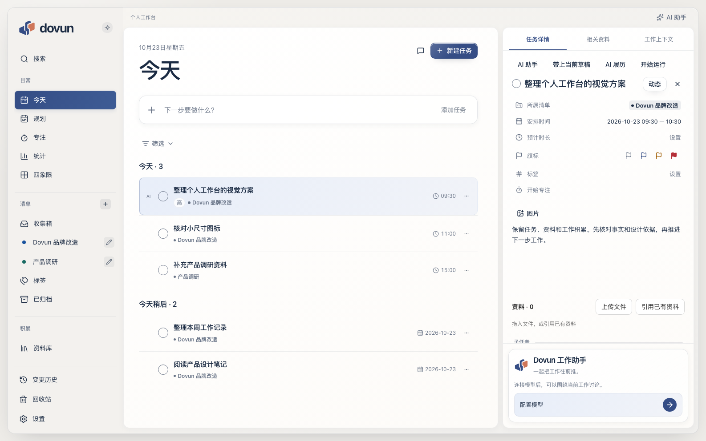
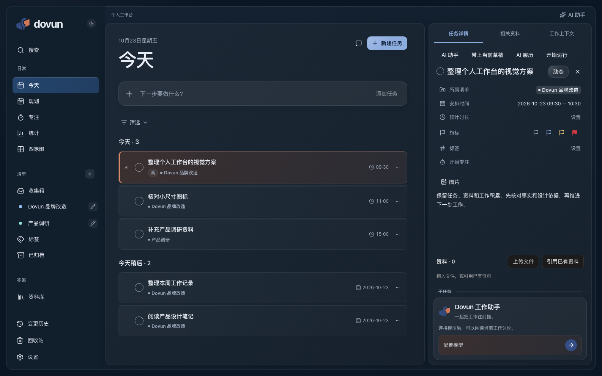
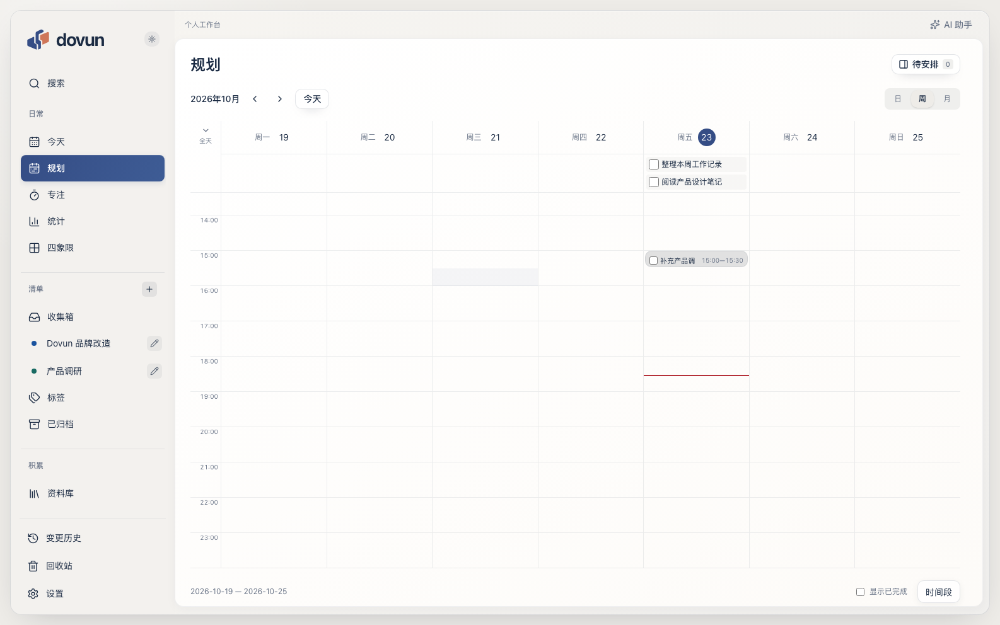
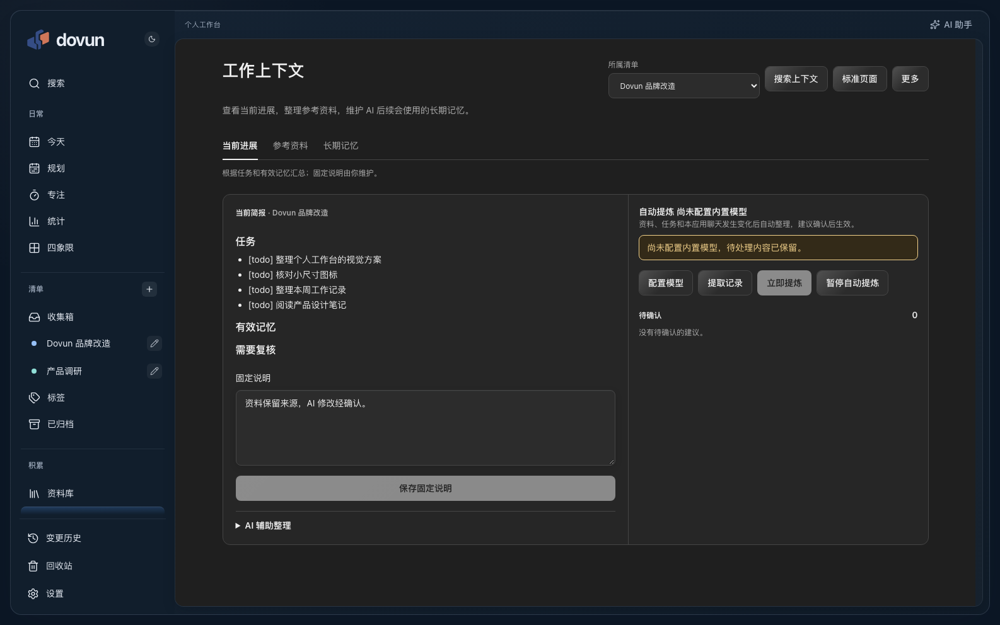
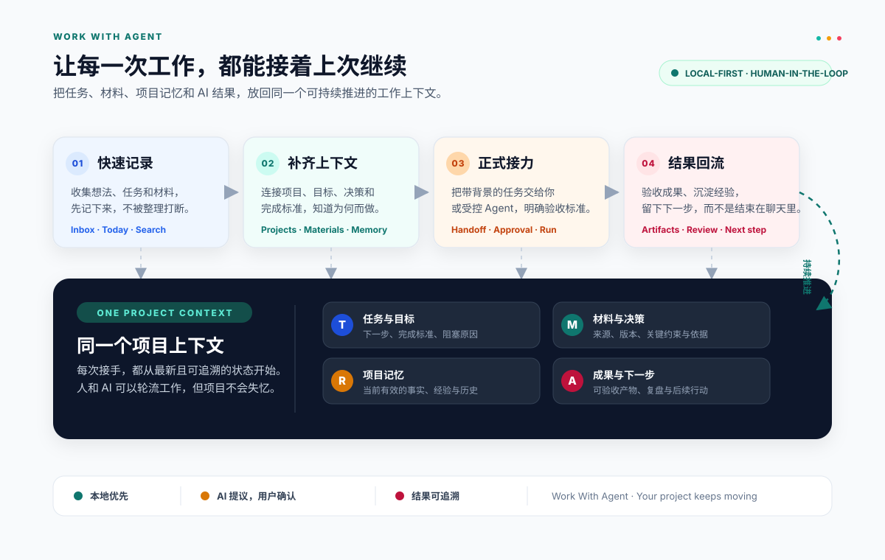

# Dovun

**简体中文** | [English](./README.en.md)


你的个人工作台。把任务、资料、安排和积累放在一起，AI 随时参与协助；AI 的修改默认等你确认。

当前分支正在实施 Dovun A/B 视觉与迁移，尚未发布 0.3.0/0.4.0。已有公开安装包仍使用旧名称；仓库与部署地址保持可用。

- **先记下来。** 收集箱、今天、清单、标签、子任务、手动排序。待办不需要模型。
- **再交给 AI。** 在「AI 连接」里复制一条配置。宿主通过 MCP 读任务、材料和记忆。
- **你点头才改。** 写入进「待确认」。可以撤销。数据在本机 SQLite，开发时 API 只听 `127.0.0.1`。

[快速开始](#quick-start) · [下载安装](#下载安装)



## 功能

| 位置 | 能做什么 |
| --- | --- |
| 收集箱、今天、清单、搜索、标签 | 记下任务，补上说明、日期、优先级和子任务，拖动调整顺序 |
| AI 连接 | 为 Codex、Claude Code 或 Grok 发一张可撤销的凭据，并圈定它能看的清单 |
| 待确认 | AI 的写入停在这里，接受或拒绝之后数据才变 |
| 工作上下文、资料库 | 保存材料、有来源的记忆，以及整理后的候选 |
| 技能 | 把常用做法写成技能，内置 AI 用到时才读取正文；可导入 SKILL.md，有版本历史，助手起草的技能要你确认后才保存 |
| AI 执行 | 把任务连同目标、约束和验收说明交接出去，再收回进展和结果 |
| 定期回顾 | 按日或按周生成一份报告和待确认建议；规则默认关闭 |
| 设置 → 语言 | 界面可在简体中文和 English 之间切换。默认跟随浏览器语言，选择后保存在本机 |

术语见 [CONTEXT.md](./CONTEXT.md)。接口与交接见 [接口与宿主接入](./docs/stages-2-5-api.md)。



「规划」按日、周、月排开有安排时间的任务，没有具体时间的放在顶部全天一栏。同一时段挤在一起的任务会叠成一张卡片。



在「工作上下文」里，确认过的记忆会按关系收成社区，也可以铺成三维地形。下图展示本轮真实工作上下文页面；三维地形仍保留在原有功能中。



## 架构

工作闭环是：快速记录、补齐上下文、正式接力、结果回流。



## 下载安装

预编译包在 [GitHub Releases](https://github.com/trillllllll/work-with-agent/releases/latest)：

- macOS Apple Silicon：`.dmg`
- Windows x64：NSIS 安装包 `.exe`

当前分支候选包的数据目录（公开旧包仍用旧目录，升级先备份校验迁移）：macOS 为 `~/Library/Application Support/dovun/`，Windows 为 `%LOCALAPPDATA%\dovun\`。应用监听 `127.0.0.1:47316`。macOS 包是 ad-hoc 签名（`desktop/src-tauri/tauri.conf.json` 里 `signingIdentity` 为 `-`），没有 Apple 公证。Windows 构建未配置代码签名。

从源码打包装见 [桌面应用](#桌面应用)。

<a id="quick-start"></a>

## 从源码运行

CI、`server/Dockerfile` 和桌面组装使用 Node.js 22。`scripts/assemble-desktop.mjs` 在主版本低于 22 时退出。

```bash
git clone https://github.com/trillllllll/work-with-agent.git
cd work-with-agent
npm install
cp server/.env.example server/.env
npm run prisma:generate
npm run db:migrate
npm run dev
```

Windows PowerShell 复制环境文件：

```powershell
Copy-Item server/.env.example server/.env
```

API 日志会打印 `Open workspace:`。打开这个链接：地址里的 `#owner-token=` 十分钟内只能用一次。Web 在 <http://127.0.0.1:5176>（Vite 把 `/api` 代理到 API），API 在 <http://127.0.0.1:3016>。待办不需要模型；内置对话在「设置」里填写 OpenAI 兼容接口、API Key 和模型名称。

## 桌面应用

窗口里仍是这个网页，数据和接口由打包进去的 Node.js 22.13.0 提供。组装只支持在 macOS Apple Silicon 或 Windows x64 上执行。开发时的 `npm run dev` 仍是 <http://127.0.0.1:5176> 和 <http://127.0.0.1:3016>。

macOS：

```bash
npm run desktop:build
```

产物在 `desktop/src-tauri/target/release/bundle/dmg/`。应用监听 `127.0.0.1:47316`，数据在 `~/Library/Application Support/dovun/`。导入开发数据前先停止开发服务、桌面应用和执行端。下面工具会备份并完整复制来源目录，保留原件，拒绝合并或覆盖冲突目录；不要只复制数据库：

```bash
node scripts/import-desktop-data.mjs
```

桌面应用开着，Codex、Claude Code 和 Grok 才能连上。在应用的「AI 连接」里重新复制配置。stdio 命令指向上面目录中的 `bin/dovun-mcp`，Grok 使用 `http://127.0.0.1:47316/mcp`。原来指向 3016 的配置仍然只连接开发服务。

Windows x64：

```powershell
npm run desktop:build:windows
```

产物在 `desktop/src-tauri/target/release/bundle/nsis/`。数据目录是 `%LOCALAPPDATA%\dovun\`。MCP stdio 配置会直接调用安装包内的 `node.exe` 和 `server/dist/mcp/index.js`。

## 接入 AI

先构建 MCP 入口，并保持服务运行：

```bash
npm run build -w server
```

打开「AI 连接」，新建 Codex、Claude Code 或 Grok，至少勾选收集箱或一个清单。凭据只在创建时出现一次。页面上的复制按钮会填好本机的 Node 路径、`server/dist/mcp/index.js` 和凭据。下面是同一份配置的样子，把路径和凭据换成你自己的：

已有 `work_with_agent` 条目时更新原条目，不执行下方新增命令；配置页可选择“更新原有条目”。下方只适用于首次连接。0.3.0 仍兼容旧 `WWA_*` 环境变量，新名称优先，差异会提示且不输出值。升级细节见 [迁移手册](docs/dovun-migration.md)。

Codex 的 `config.toml`：

```toml
[mcp_servers.dovun]
command = "node"
args = ["/absolute/path/to/work-with-agent/server/dist/mcp/index.js"]

[mcp_servers.dovun.env]
DOVUN_API_URL = "http://127.0.0.1:3016"
DOVUN_CONNECTION_TOKEN = "创建连接时显示的凭据"
```

Claude Code：

```bash
claude mcp add dovun node "/absolute/path/to/work-with-agent/server/dist/mcp/index.js" --scope user --env DOVUN_API_URL=http://127.0.0.1:3016 DOVUN_CONNECTION_TOKEN=创建连接时显示的凭据
```

Grok：

```bash
grok mcp add dovun --scope user --transport http http://127.0.0.1:3016/mcp --header "Authorization: Bearer 创建连接时显示的凭据"
```

重新加载宿主的 MCP，让它调用 `list_tasks`。没有勾选「允许直接执行」的写入会进「待确认」，这时数据还没有改。`get_task` 会附带任务说明里引用的截图，材料原件用 `get_material_attachment` 读取。

## 自托管与多端同步

默认每台电脑各自一份数据。要让桌面应用和手机浏览器共用同一份时，用仓库根目录的 `docker-compose.yml` 起一个常开实例。完整步骤、反向代理和快照迁移见 [自托管服务器部署](./docs/deployment.md)。

必填两项：`DOVUN_OWNER_KEY`（至少 20 个字符；`openssl rand -base64 32`）和 `DOVUN_PUBLIC_URL`（浏览器访问地址，cookie 与 CORS 跟着它）。可以导出到环境变量，或写在仓库根目录的 `.env` 里。compose 文件头部也说明可以把变量写进 `compose.override.yml`。

```bash
openssl rand -base64 32
docker compose up -d --build
docker compose logs -f
```

日志出现 `API listening` 即进程已起来。容器把宿主机的 `127.0.0.1:12716` 转到容器内的 `3016`，不直接对公网监听。数据在 `./data`（挂到容器的 `/data`）。

桌面应用启动时选「连接服务器」，之后也能从应用内的「服务器」入口切回本机模式。手机或浏览器打开 `DOVUN_PUBLIC_URL`，用 `DOVUN_OWNER_KEY` 登录。服务器模式下没有一次性启动链接。

## 配置

下表只列 `server/.env.example` 和 `docker-compose.yml` 里的变量。本地开发复制 `.env.example` 即可；注释掉的项有默认行为。

| 变量 | 何处 | 作用 |
| --- | --- | --- |
| `DATABASE_URL` | `.env.example` | SQLite。示例 `file:../data/dovun.db`，相对 `server/prisma/schema.prisma`，即 `server/data/dovun.db` |
| `PORT` | `.env.example`（注释） | 默认 `3016` |
| `CLIENT_ORIGIN` | 两处 | 本地示例 `http://127.0.0.1:5176,http://localhost:5176`。compose 里设为 `DOVUN_PUBLIC_URL` |
| `KNOWLEDGE_STORAGE_ROOT` | `.env.example`（注释） | 可选，材料文件的绝对路径 |
| `DOVUN_RUNNER_DIR` | `.env.example`（注释） | 可选，执行器目录的绝对路径 |
| `DOVUN_CODEX_BIN` | `.env.example`（注释） | 可选，Codex 可执行文件的绝对路径 |
| `DOVUN_CLAUDE_BIN` | `.env.example`（注释） | 可选，Claude Code 可执行文件的绝对路径 |
| `DOVUN_CODEX_WINDOWS_SANDBOX` | `.env.example`（注释） | Windows 上 `unelevated`（默认）或 `elevated` |
| `BRAVE_IMAGE_SEARCH_KEY` | 两处 | 可选。图片搜索密钥只留在服务端 |
| `BRAVE_IMAGE_SEARCH_PROXY_URL` | `docker-compose.yml` | 可选。图片搜索出口代理 |
| `DOVUN_OWNER_KEY` | `docker-compose.yml`（必填） | 自托管登录密钥，至少 20 个字符 |
| `DOVUN_PUBLIC_URL` | `docker-compose.yml`（必填） | 浏览器使用的地址，例如 `https://wwa.example.com` |
| `DOVUN_PUBLIC_HTTPS` | `docker-compose.yml` | 固定为 `1` |
| `TZ` | `docker-compose.yml` | 默认 `Asia/Shanghai` |

## 项目结构

| 路径 | 内容 |
| --- | --- |
| `client/` | React 19、Vite、TypeScript、Tailwind。开发服务器 `127.0.0.1:5176`。语言包在 `client/src/i18n/locales/` |
| `server/` | Node.js、Express 5、Prisma、SQLite。入口 `server/src/index.ts`，MCP 在 `server/src/mcp/` |
| `desktop/` | Tauri 壳。配置在 `desktop/src-tauri/` |
| `e2e/` | Playwright |
| `scripts/` | 测试封装、备份、桌面组装与导入 |
| `docs/` | 产品说明与 [部署](./docs/deployment.md) |

根目录还有 `architecture.svg`、`docker-compose.yml` 和 `package.json`。

## 开发与测试

命令都来自根目录 `package.json`。

| 命令 | 作用 |
| --- | --- |
| `npm run dev` | 同时启动 server 与 client |
| `npm run build` | 先构建 server，再构建 client |
| `npm run prisma:generate` | 生成 Prisma Client |
| `npm run db:migrate` | 迁移数据库 |
| `npm test` | `scripts/test.mjs`：按需生成 Client、迁移，再跑 server 与 client 的 Vitest |
| `npm run i18n:check` | 检查中英文语言包的键一致，且 `client/src` 里没有遗留的中文字面量 |
| `npm run e2e` | Playwright |
| `npm run test:all` | `npm test` 然后 `npm run e2e` |
| `npm run e2e:real` | 真实模型冒烟。需要 `E2E_REAL_MODEL`、`E2E_MODEL_BASE_URL`、`E2E_MODEL_API_KEY`、`E2E_MODEL_NAME` |
| `npm run test:library:migration` | 资料库迁移排练 |
| `npm run test:library:performance` | 资料库性能脚本 |
| `npm run db:backup` | 把 SQLite、材料目录和 runner 目录备份到 `.backups/`。先停 API 和 runner |
| `npm run desktop:assemble` | 组装桌面运行时（要求 Node.js 22，且为 macOS Apple Silicon 或 Windows x64） |
| `npm run desktop:dev` | 组装后启动 Tauri |
| `npm run desktop:build` | 组装并按 `tauri.conf.json` 打 `app` 与 `dmg` |
| `npm run desktop:build:windows` | 组装并打 NSIS（`--bundles nsis`） |
| `npm run desktop:smoke` | 检查已组装的桌面运行时 |

CI（`.github/workflows/ci.yml`）在 Node.js 22 上执行 `npm ci`、`npm run prisma:generate`、`npm run i18n:check`、`npm test` 和 `npm run build`。

## 数据与安全

- 开发时 API 默认只监听 `127.0.0.1`。数据库是 SQLite。
- 模型 API Key 存在服务端。对外只返回掩码。`BRAVE_IMAGE_SEARCH_KEY` 不下发到客户端。
- 外部 AI 使用单独凭据。未列入直接执行的写入进入「待确认」。
- 「变更历史」留下操作记录，一部分可以撤销。

细节见 [本机身份](./docs/stages-2-5-api.md#本机身份)。

## 许可与贡献

[Apache License 2.0](./LICENSE)。欢迎 Issue 和 Pull Request。提交前请运行 `npm run test:all`，并在 PR 里写明行为变化和测试覆盖。
