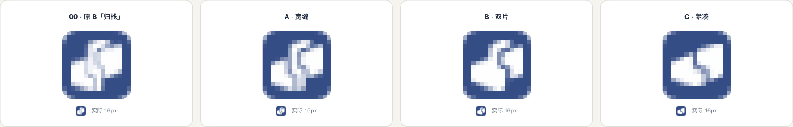

# Dovun 归栈宽缝图标设计理念

2026 年 10 月 23 日，选定 Dovun「归栈」方向的 **A 宽缝** 作为当前图标方案。品牌定位是**个人工作台**：把任务、资料、计划、进展和积累放在自己的工作空间里，AI 参与协助，工作成果持续留在这里。

## 核心理念

**把分散的工作归到一起，又让每一部分保持清楚。**

图形以错位排列的工作卡片为基础。左下的深蓝卡片、中间带台阶的深蓝索引脊，以及右上的珊瑚色卡片，组成一个向右上展开的整体。卡片让人联想到正在处理的任务、页面和资料；贯穿其中的索引脊表达共同的组织和工作上下文。各部分不固定对应某一个具体功能，便于产品继续发展。

“归栈”表达工作被收拢、关联和积累。图标的识别点来自**三片错位的轮廓、中央回折的台阶，以及两道敞开的宽缝**。整体用少量大色块表达个人工作空间，避免继续堆叠窗口边框、勾号或字母等符号。

## 为什么保留宽缝

这轮选择保留三片结构。相较于原始归栈图，宽缝让每一片之间的边界更明确，也保留了中央索引脊的特征。精修的重点是减掉细小凹口、扩大负空间，维持原有错位关系。

后续绘制应保留三片构成、中央回折、向右上错位的节奏、宽阔色面和圆润外角。两道缝需要在缩小后仍能分开各片。不要在矢量化时自行合并成两片，也不要改回单字母或普通窗口图标。

## 色彩与名称

| 元素 | 参考颜色 | 设计意图 |
| --- | --- | --- |
| 左侧卡片与中央索引脊 | 深蓝 `#354d85` | 稳定、可持续积累的工作基础 |
| 右侧卡片 | 暖珊瑚 `#cf7659` | 为正在展开的工作提供视觉焦点 |

以上为目标色板。当前生成图含有轻微明暗变化，尚不是严格的纯色矢量稿；颜色不作为应用中任务优先级或状态的既定规范。

品牌名使用 **Dovun**。对照页中的小写 `dovun` 仅用于字标搭配示意，专用字体与字标细节尚未定稿。

## 小尺寸与交付状态

已有 16、24、32 px 的预览，对照时将有效图形统一放在方形画布约 80% 的范围内。下面的对照图包含原版、A 宽缝、B 双片、C 紧凑；**本次选定的是 A 宽缝**。

宽缝稿在 16 px 下仍有三片结构带来的复杂度。当前选择确认的是图形方向，后续需完成矢量重绘、曲线与边缘清理、缝宽及像素对齐，再导出正式 favicon 和应用图标。现存 PNG 为 1254 × 1254 的透明背景概念图，按原文件保存，没有重新描绘或压缩。

当前归栈宽缝图形尚未完成反向搜图和商标图形近似检索。此前「宽窗」图标的排查针对另一套图形，不能作为本稿的查重结论。

## 归档文件

- [当前选定图稿](assets/dovun-icon-wide-gap.png)：后续精修的基准。
- [原始归栈图](reference/original-stack.png)：保留造型来源，供比对。
- [选定稿生成提示词](source/selected-prompt.json)：只记录 A 宽缝的提示词。
- [文件清单与校验值](source/manifest.json)：记录选定日期、来源、尺寸和 SHA256。
- [小尺寸预览检查记录](reference/preview-checks.json)：保留这轮预览的方法与检查结果。

上文记录图形选定时的原始设计状态。现已完成纯色矢量重绘并用于真实应用、favicon、启动页与桌面图标，见 [实际应用改造](implementation/README.md)。0.3.0 系统标识仍保留旧值。

## 工作台改造样板

同日开始 Dovun 工作台改造，产出 [可点击视觉样板](prototype/index.html)、[视觉规范与矢量候选](visual-spec.md) 和 [分阶段实施记录](rollout-plan.md)。矢量稿在原选定方向上整理为纯色，供本批审查；上面的原始 PNG 与来源记录保持不变。旧样板保留作历史记录；正式界面与 0.3.0 迁移的最新状态见 [实施进度](rollout-plan.md)。

## 当前控件样式规范

2026 年 10 月 24 日，控件改造采用已确认工作台默认材质，基础字号调整为 14px。浅深色的静态变量、组件复用、实际页面截图和测试结果见 [全系统控件统一](controls-unification/README.md)；[截图对照页](controls-unification/index.html) 可切换浅深色及手机布局。布局沿用已落地版本，之前的任务密度实验继续保留。此次源码改造不包含安装或部署。
