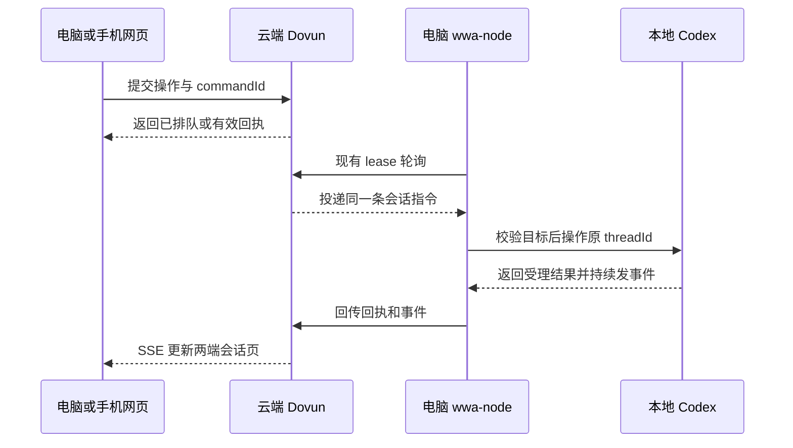

# Dovun 手机接续 Codex 会话首版实现方案

首版实现随 Dovun 0.6.5 交付。[手机遥控调研报告](2026-11-20_mobile-agent-relay-research.md)

## 目标与首版范围

用户在电脑打开 Dovun 网页，选一台已配对的电脑和一个已验证的项目位置，开启 Codex 会话。手机登录同一云端工作区后，可以打开原会话、看历史与实时输出、发送下一轮消息、追加或打断当前轮，以及回应 Codex 的权限请求。回到电脑能看到同一段历史，底层 `threadId` 始终一致。

首版每台电脑同时持有一条由 Dovun 启动的 Codex 会话。电脑本地运行 Codex，云端 Dovun 负责鉴权、投递和事件转发，电脑和手机共用网页。控制后台由已配对的 `wwa-node` 承担。退出网页后，已经启动的轮次由电脑继续处理。

三端分工参考 ZCode。首版沿用 Dovun 的 HTTP 接口和 `/lease` 轮询投递操作，网页通过 SSE 收事件。`stdio` 用于电脑内部的 `wwa-node` 与 `codex app-server` 通信。扩展到其他 harness 时复用网页与中继的会话协议，由本机适配器处理各自的运行协议。

## 本机 harness 接入顺序

以下版本和命令入口来自 2026-11-21 的本机盘点。首版验收聚焦 Codex，后续按会话适配能力分批接入。

| 批次 | 本机 harness | 适配依据与验收重点 |
|---|---|---|
| 首版 | **Codex 0.166.0** | 使用 App Server。已在隔离项目验证握手、开轮、追加和打断。真实 Codex 流式完成两轮，重启后恢复原线程和历史，并通过适配器回复原生审批。 |
| 第二批 | **Claude Code 2.1.328** | Dovun 已有批处理入口。本机 CLI 有流式 JSON 输入、输出和 `--resume`，优先验证多轮接续、打断和权限回复，再接入远控会话。[现有运行器](../server/src/runner/contracts.ts) |
| 第二批 | **ZCode 3.18.2** | 本机 `ZCode.app` 内有 `Contents/Resources/glm/zcode.cjs`。按同版本 V4 会话协议验证接续和命令回执，再接入远控会话。[ZCode V4 会话协议](https://github.com/zai-org/ZCode/blob/fec975905a2abd4c07e35c40d51fa097a2258ec9/docs/zcode-protocol.md) |
| 后续候选 | **OpenCode、Kimi Code、Gemini CLI、Pi** | 本机 CLI 帮助已确认前三个有 ACP 入口，Pi 有 RPC 模式。逐个验证同一会话恢复、打断和审批，再确认接入范围。 |
| 待评估 | **DeepSeek Harness、Grok Build、Kiro CLI、CodeBuddy** | 已找到本机安装或命令入口。运行协议和可接续的会话类型待核验。 |

## 现有入口与改动位置

| 位置 | 复用入口 | 首版改动 |
|---|---|---|
| 电脑控制端 | [执行器轮询和关停](../server/src/node-agent/agent.ts)、[CLI 查找](../server/src/node-agent/cli.ts)、[本机目录校验](../server/src/node-agent/git.ts) | 在 `NodeAgent` 增加会话指令处理，接一个本地 Codex 适配器。适配器持有 `codex app-server` 的 stdio、线程和命令回执。 |
| 云端 Dovun | [节点路由](../server/src/routes/orchestration.ts)、[节点领任务与鉴权](../server/src/application/orchestration/nodes.ts)、[项目位置](../server/src/application/orchestration/projects.ts)、[应用路由鉴权](../server/src/app.ts) | 为会话单独建路由和服务。扩展现有节点协议，保存会话绑定和命令投递状态，转发电脑生成的事件和快照。 |
| 电脑和手机网页 | [运行页](../client/src/components/workspace/HandoffPanel.tsx)、[网页路由](../client/src/hooks/useHashRoute.ts)、[现有 EventSource 用法](../client/src/hooks/useWorkspaceEvents.ts) | 在「运行」页加「会话」入口，沿用 `#/runs?tab=sessions&sessionId=…`。复用现有 Button、NativeSelect、Textarea 和 Surface。两端共用会话详情，通过专用 SSE 接收会话事件。 |

现有批处理 [worker](../server/src/runner/worker.ts) 发出 prompt 后关闭 stdin，继续服务编排任务。交互适配器单独管理长连接和多轮输入。首版网页直接访问云端工作区，云端向电脑下发操作走节点接口。

## 接口与数据

### 网页接口

沿用浏览器 owner 会话鉴权和 CSRF。列表和详情包含会话状态、电脑状态、项目和最近活动时间。网页通过 Dovun `sessionId` 访问会话。

| 接口 | 请求与结果 |
|---|---|
| `GET /api/v1/harness-sessions` | 列出用户可用的会话及电脑状态。用现有电脑和项目接口选择在线、已协商支持、项目位置已校验的执行器。 |
| `POST /api/v1/harness-sessions` | 入参为 `nodeId`、`locationId`、稳定 `commandId`。在同一事务创建会话记录和启动指令，返回 `sessionId` 与投递状态。 |
| `GET /api/v1/harness-sessions/:id` | 读会话详情和当前同步状态，供初次进入与页面刷新使用。 |
| `POST /api/v1/harness-sessions/:id/commands` | 提交 `commandId`、`expectedEpoch`、操作及参数，返回投递状态。目标节点、项目和 Codex 线程由服务端从绑定解析。 |
| `GET /api/v1/harness-sessions/:id/commands/:commandId` | 查询同一操作的回执，供弱网超时、页面刷新和重复送达时恢复界面。 |
| `GET /api/v1/harness-sessions/:id/events` | SSE 返回快照、增量和命令回执。订阅携带最后应用的 `(epoch, seq)`，命令回执按 `commandId` 更新。 |

操作只接收 `send`、`steer`、`interrupt` 和 `resolveApproval`。`send` 要求会话空闲。追加和打断需要 `turnId`，审批需要原请求 ID 和决定。服务端校验请求格式，电脑根据本机状态裁决。命令 ID 复用冲突、代次过期、轮次或权限请求变化均返回明确原因，供网页刷新状态后展示。

### 节点接口

新执行器用 `X-Dovun-Node-Features` 请求能力协商。服务端支持时在 `/api/v1/node/lease` 的 `accepts` 中返回会话能力，执行器下一次轮询才在 `capabilities` 声明支持。双端确认后，`lease` 响应才附带 `harness`，其中包含会话命令和快照请求。旧端继续处理 `jobs` 和 `cancel`，请求和响应结构兼容。节点轮询间隔沿用默认 3 秒，已启动会话的输入、打断和审批可在批处理槽位满时领取。[节点协议](../server/src/node-agent/protocol.ts)

新增 `POST /api/v1/node/harness-sessions/:id/sync`，沿用 `nodeMiddleware`。请求按类型上报线程绑定、命令回执、快照或一批事件。每次检查认证得到的电脑 ID 与会话绑定一致。回传重试沿用原回执 ID 或事件序号，响应返回已接收的水位。节点撤销后，服务端停止派发，节点走现有的撤销处理关闭本地会话适配器。

### 存储职责

| 记录 | 存储与约束 |
|---|---|
| 会话绑定 | 服务端持久化 `sessionId`、`nodeId`、`locationId`、`threadId` 和最新有效 `epoch`。创建请求按工作区与 `commandId` 去重，并通过唯一约束确保节点同时只有一条活动会话。电脑先上报含线程 ID 的快照，再上报启动回执。恢复时校验返回同一个 ID。 |
| 命令投递 | 服务端以 `(sessionId, commandId)` 为唯一键，保存标准化命令及目标代次、投递状态与电脑回执。投递记录与会话索引持久化，服务重启后继续用于查重和查回执。 |
| 本地会话 | 执行器数据目录保存原 `threadId`、已校验的 `cwd`、日志代次和已受理命令记录。Codex 原生历史保存在电脑上。服务器持有有界快照和增量缓存，缓存不足时向电脑重新取快照。 |

## 从电脑开会话到手机接续

1. 启动时，服务器从已验证的 `ProjectLocation` 解析项目路径。电脑用 `assertAllowed` 校验真实路径，将 `cwd` 固定在会话绑定。适配器启动本地 `codex app-server`，完成握手后调用 `thread/start`，保存并上报返回的 `threadId`。
2. 网页打开同一个 `sessionId`。当会话空闲时，发送 `send`，电脑在原线程上调用 `turn/start`。运行中使用 `steer` 或 `interrupt`，分别对应 `turn/steer` 和 `turn/interrupt`，并核对目标 `turnId`。迟到的操作返回状态冲突，输入留在草稿。
3. Codex 发出权限请求时，适配器保存对应的代次、轮次和原请求 ID。网页显示操作详情与当前可选决定。首版提供允许一次或拒绝，依据本机 Codex 策略和该请求支持的选项处理。电脑先占用请求，再回复原请求。最终状态以 Codex 的请求关闭和操作事件为准。工作目录校验负责限定会话入口，工具权限由本机 Codex 策略执行。
4. 执行器重启时先确认只有一个进程持有该会话，再根据本地绑定校验项目路径，调用 `thread/resume` 恢复原线程和已保存历史。原轮结果根据 Codex 回读标记已完成、中断或待核实。若原线程无法打开，保留绑定并显示失败原因。[Codex App Server 协议](https://developers.openai.com/codex/app-server/)

## 断线与命令重试

### 恢复网页状态

- 命令之外的会话变化用电脑发出的事件表达。每条事件含 `sessionId`、`epoch`、`seq`、类型和正文。首版处理消息增量、轮次状态、权限请求及其结果。电脑对同一代次按顺序回传事件，服务器按事件坐标去重后转发。
- 手机刷新、切回前台或 SSE 断开时带上最后应用的游标。同代次且能补齐缺口，就补 `seq+1` 起的增量。缓存缺失或代次变化时，服务器经下一次 `lease` 向电脑请求快照。快照带当前代次和捕获时的序号，并给出最近消息、当前轮次和待处理请求。
- 网页用快照替换会话视图，再从快照水位之后接增量。代次由电脑持久化并在重建会话投影时递增，手机单独断网沿用原代次。服务端收到更高代次的快照后才切换，两端都丢弃旧代次的迟到数据。浏览器分别按事件游标和 `commandId` 恢复会话视图和命令回执。
- 电脑离线时显示最后已知状态并保留草稿。重连后先恢复会话状态，再由用户决定是否发送草稿。[ZCode 快照和增量恢复](https://github.com/zai-org/ZCode/blob/fec975905a2abd4c07e35c40d51fa097a2258ec9/apps/zcode-cli/packages/bootstrap/src/zcode-protocol-v4/conversation-topic-publisher.ts#L674-L726)

### 去重和不确定结果

1. 网页在首次提交前保存 `commandId`。HTTP 超时、刷新和重试继续查原 ID。服务端重复收到相同内容时返回原投递状态，同 ID 换参数返回冲突。
2. 电脑收到指令后先查本地记录，已处理的指令跨代次仍返回原回执。新指令先按会话串行检查代次、空闲或运行状态、目标轮次及审批请求，再持久化将要调用的操作，随后交给 Codex。串行范围到 Codex 受理或拒绝为止，生成期间可以继续受理打断。
3. UI 区分「服务器已收到」「Codex 已受理」「轮次已结束」。如果电脑在调用后和记录回执前退出，重启先读取原会话与已有回执。回读能证实结果就更新原记录，仍不明确时标记「待核实」并暂停自动重试。
4. 已排队但还未领取的命令超过投递期限后显示未送达。已经投递却迟迟没有电脑回执的命令继续按原 ID 查证。这样能区分真正未送达和可能已执行。[ZCode 命令收件箱](https://github.com/zai-org/ZCode/blob/fec975905a2abd4c07e35c40d51fa097a2258ec9/apps/zcode-cli/packages/bootstrap/src/zcode-protocol-v4/command-inbox.ts#L174-L210)

## 实施顺序与验收

| 顺序 | 要做的改动 | 完成条件 |
|---|---|---|
| 1. 本机适配器 | 先用隔离项目和真实 Codex CLI 核对握手、线程启动与重开、流式输出、追加、打断和原生权限回复。把已验证的协议行为收进适配器。 | 由同一个 `threadId` 完成两轮交互。关闭本地适配器后按 ID 恢复原历史。 |
| 2. 中继投递与回执 | 增量新增会话和命令表，接入能力协商、`lease` 投递、本地命令记录与回执查询。 | 一个操作在响应丢失及重复投递时只交给 Codex 一次。旧执行器和原编排仍能跑完，批处理满槽时仍能控制已启动会话。 |
| 3. 事件同步与恢复 | 接入操作回传、SSE、快照和增量。用测试客户端覆盖快照水位与并发事件。 | 短断线补齐增量。跳号和新代次从快照恢复。旧事件、重复回执和旧轮打断都无法改变新状态。 |
| 4. 网页接入与真机 | 在运行页接电脑选择、会话详情、输入、打断、审批、离线草稿和回执反馈。电脑与真实手机使用同一云端测试工作区。 | 电脑 → 手机 → 电脑完整走通，同一 `threadId` 贯穿。换网、刷新、电脑重启和两端同时操作时结果符合下表。 |

| 验收场景 | 要观察的证据 |
|---|---|
| 同会话接续 | 电脑发第一句，手机看到历史和实时输出，用手机追加当前轮、空闲后再发一轮。回电脑确认两端输入与回复一致，绑定的线程 ID 相同。 |
| 断网、掉线与重启 | 手机短断线补齐增量，长断线走快照。电脑离线时保留草稿。重启后恢复原线程历史，并确认旧代次事件、待确认卡和打断操作按原目标处理。 |
| 命令重复与崩溃 | 模拟服务端响应丢失、电脑回执丢失和同 ID 携不同参数。记录底层调用次数，并验证无法确认的命令显示「待核实」。 |
| 两端同时控制 | 延迟送达上一轮的打断，新一轮继续运行。电脑和手机同时回应同一个权限请求，Codex 只接收一次有效决定，两端看到最终结果。 |
| 兼容与权限 | 分别验证新旧节点与服务端混用。用其他节点凭据回传和用未授权目录启动时均失败。管理员撤销电脑后不能继续投递。 |

服务和执行器回归沿用 [节点代理测试](../server/src/node-agent/agent.test.ts)及[现有编排测试](../e2e/orchestration.e2e.ts)的测试入口。真机结果与受控运行分别记录，发版前再按仓库规范更新应用功能手册。

## ZCode 本机账号模型

Mac 执行器仍使用 ZCode 的 V4 会话协议、原生会话 ID 和原会话占用检查。恢复会话时，执行器可启动与本机 ZCode 版本匹配的账号宿主。宿主自行解析 ZCode 当前版本的模型目录、检查 CLI 账号授权，并在本机完成模型请求鉴权。手机模型列表取原生会话返回的可选项。通过原生刷新入口可以重新读取目录与授权。

当前宿主基于 ZCode v4.0.0。将该版本检出到临时目录，用 Node 24 执行 `node scripts/zcode-account-host/build.mjs <检出目录>`，产物进入 `.cache/zcode-account-host`。Mac 打包时校验并收录该产物。Mac 缺少对应宿主时，执行器继续使用安装的 ZCode CLI。

账号宿主默认读取 ZCode CLI 的账号授权。为 Dovun 单独授权时，将官方 CLI 的 `ZCODE_CREDENTIALS_FILE` 指到 `~/.zcode/v2/dovun-account/credentials.json`，将本次登录的 `ZCODE_PERSONAL_PROVIDER_CONFIG_FILE` 指到同目录的 `provider_config.json`，执行 `login bigmodel`。首次授权时，系统钥匙串不可用的场景可以使用 ZCode 原生支持的同目录 `credential-secret` 私有文件，权限设为 `0600`。执行器发现专用凭据库后，会优先用它授权账号模型，并继续读取 ZCode 的个人模型目录。

验收需分别验证读取项目下的旧对话、恢复原会话 ID、刷新后显示已授权的模型、切换模型后同会话发送并收到流式回复，以及旧模型不可用时能切换到实际可用的模型。
